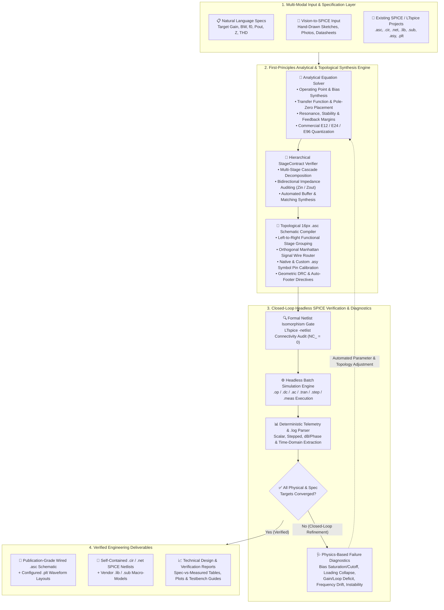

<div align="center">

# ⚡ AI-SPICE

**Universal Autonomous AI Framework for Electronic Circuit Design, First-Principles Analytical Sizing, Closed-Loop LTspice Verification, Vision-to-SPICE Reconstruction, and Orthogonal Signal-Wired `.asc` Schematic Compilation.**

[](LICENSE)
[](pyproject.toml)
[](#)
[](src/ai_spice/mcp_server.py)
[](tests/)
[](llms.txt)

[**🏛️ System Architecture**](#️-system-architecture) · [**🌐 Supported Domains**](#-supported-engineering-domains--analyses) · [**🤖 For AI Agents & MCP**](#-for-ai-agents--llm-discovery) · [**🔌 Topological `.asc` Compiler**](#-topological-stage-flow--orthogonal-signal-wired-asc-compiler) · [**📸 Vision-to-SPICE**](#-vision-to-spice-multi-modal-schematic-reconstruction) · [**🚀 Quickstart**](#-quickstart)

</div>

---

## 💡 Overview

**AI-SPICE** bridges the gap between Large Language Models (*OpenAI Codex, Claude Code, Cursor, Gemini, Copilot*) and industrial-grade **SPICE / LTspice electronic engineering**.

When standard LLMs are asked to design or modify electronic circuits directly, they hallucinate component values without solving physical equations, ignore inter-stage impedance loading across cascaded blocks, and fail to generate valid visual LTspice `.asc` schematics—resulting in floating pins (`NC_`), short-circuited wires, or unreadable clouds of disconnected net labels.

**AI-SPICE transforms any AI agent into a rigorous, closed-loop hardware engineering workstation:**
1. **First-Principles Analytical Synthesis**: Computes DC operating points, small-signal transfer functions $H(s)$, frequency-domain pole-zero placement, stability & feedback margins, power/thermal budgets, and commercial **E-series (`E12 / E24 / E96`)** component quantization before generating SPICE code.
2. **Hierarchical Inter-Stage Impedance Contracts (`StageContract`)**: Models arbitrary multi-stage systems with explicit input/output impedance boundaries ($Z_{\text{in}}, Z_{\text{out}}$), preventing loading collapse and automatically synthesizing isolation or matching stages when required.
3. **Closed-Loop Headless LTspice Verification & Physics Diagnostics**: Executes batch simulations (`.op`, `.dc`, `.ac`, `.tran`, `.step`, `.meas`), parses telemetry logs deterministically, diagnoses physical failure modes, and iterates autonomously until all target specifications converge.
4. **Topological 16-Pixel Grid `.asc` Compiler & Orthogonal Router**: Compiles any SPICE netlist (`.cir` / `.net`) or vision graph into a textbook-grade LTspice `.asc` schematic—partitioning functional stages left-to-right and connecting **100% of signal, bias, and feedback paths with physical orthogonal `WIRE` segments (`NC_ = 0`)**, while keeping power rails (`VCC`, `VEE`, `VDD`, `VSS`) and Ground (`0`) on clean local flags.

---

## 🏛️ System Architecture



---

## 🌐 Supported Engineering Domains & Analyses

AI-SPICE is architected as a **domain-agnostic electronic engineering platform** supporting discrete, integrated, and macro-model circuit topologies across all standard SPICE simulation domains:

| Engineering Domain | Representative Topologies & Building Blocks | Supported SPICE Verification & `.meas` Telemetry |
| :--- | :--- | :--- |
| **Analog & Precision Signal Conditioning** | Multi-stage discrete & Op-Amp amplifiers, instrumentation & differential front-ends, transimpedance (TIA) & charge amplifiers, active filters (Sallen-Key, MFB, State-Variable), current mirrors | `.op`, `.dc`, `.ac`, `.tran` — DC bias auditing, open/closed-loop gain, phase margin, CMRR, bandwidth ($f_L, f_H$), input/output impedance |
| **RF, High-Frequency & Wireless** | Harmonic & relaxation oscillators (VCOs, Colpitts, Hartley, Clapp, Pierce), varactor tuning networks, PLL building blocks, LNAs, mixers, RF preamplifiers, $50\,\Omega$ buffers, LC/RLC matching networks | `.tran ... startup`, `.ac`, FFT/harmonic extraction — carrier frequency $f_0$, tuning sensitivity, startup margin, harmonic suppression, RF output power |
| **Audio & Power Amplification** | Low-noise preamplifiers, active tone/equalization stages, voltage amplifier stages (VAS), diode/$V_{BE}$-multiplier bias chains, complementary push-pull Class-A / Class-AB output stages, Zobel & Boucherot networks | `.tran`, `.ac`, `.four` — RMS load power, peak-to-peak swing, crossover distortion, quiescent current, slew-rate & compensation stability |
| **Passive & Active Filter Synthesis** | Low-pass, high-pass, band-pass, band-stop / notch filters (RC, RL, series/parallel RLC, LC ladders, cascaded active stages) | `.ac dec` — center/cutoff frequencies ($f_0, f_{-3\text{dB}}$), quality factor $Q$, passband insertion loss, stopband attenuation (dB) |
| **Power Management & Regulation** | Linear regulators, LDO topologies, shunt/series voltage references, over-current protection, decoupling & ripple-filtering banks, switching stage primitives | `.dc`, `.tran`, `.step param` — line/load regulation, dropout voltage, transient step response, power dissipation & efficiency ($\eta$) |
| **Multi-Modal Vision & Legacy Refactoring** | Incomplete textbook diagrams, whiteboard sketches, photographed schematics, legacy netlists (`.cir`), and unorganized `.asc` files | `ask_user` interactive parameter audit, `autonomous` equation-based completion, `.cir` $\leftrightarrow$ `.asc` compilation, and automatic schematic wire routing |

---

## 🏆 Ecosystem Comparison (2024–2026)

| Tool / Framework | Primary Scope | Analytical Sizing & Commercial E-Series | Multi-Stage Impedance Contracts | Closed-Loop LTspice `.meas` Verification | Vision-to-SPICE Reconstruction | Full `.asc`/`.cir`/`.asy`/`.plt` Project AST | Topological Signal-Wired `.asc` Compiler (`NC_ = 0`) |
| :--- | :--- | :---: | :---: | :---: | :---: | :---: | :---: |
| **⚡ AI-SPICE (This Repo)** | **Universal AI Circuit Engineering Framework** | ✅ **Yes (Multi-Domain Equations + E12–E96)** | ✅ **Yes (`StageContract`)** | ✅ **Yes (Automated Loop + Diagnostics)** | ✅ **Yes (`ask_user` & `autonomous`)** | ✅ **Yes (All 8 LTspice Formats)** | ✅ **Yes (Topological Blocks + Orthogonal Wiring + DRC)** |
| `PyLTSpice` / `spicelib` | Python Simulation Wrapper | ❌ No | ❌ No | ✅ Yes | ❌ No | ⚠️ Partial | ❌ No (No schematic synthesis) |
| `SKiDL` / `atopile` | Hardware-as-Code PCB DSL | ❌ No | ❌ No | ❌ No | ❌ No | ❌ (KiCad PCB focus) | ❌ No |
| `ltspice-mcp` Wrappers | Basic CLI-to-MCP Bridge | ❌ No | ❌ No | ✅ Yes | ❌ No | ⚠️ Basic | ❌ No |
| `AnalogCoder` / Academic Agents | Netlist-Only Script Generators | ❌ No (Black-box search) | ❌ No | ❌ (`PySpice` only) | ❌ No | ❌ No | ❌ No |

---

## 🤖 For AI Agents & LLM Discovery

> **Are you an AI coding agent (*OpenAI Codex, Claude Code, Cursor, Windsurf, Gemini, GitHub Copilot*) tasked with designing, simulating, debugging, or generating LTspice schematics (`.asc`) and SPICE netlists (`.cir`)?**
>
> This repository provides native auto-discovery manifests and instruction protocols for every major agentic workflow:
> - **OpenAI Codex / ChatGPT / Jules**: [`AGENTS.md`](AGENTS.md)
> - **Anthropic Claude Code**: [`CLAUDE.md`](CLAUDE.md)
> - **Cursor IDE**: [`.cursorrules`](.cursorrules)
> - **GitHub Copilot**: [`.github/copilot-instructions.md`](.github/copilot-instructions.md)
> - **LLM Search & RAG Index**: [`llms.txt`](llms.txt)
> - **Model Context Protocol (MCP) Manifests**: [`mcp.json`](mcp.json) & [`smithery.yaml`](smithery.yaml)

### Instant Agent Bootstrap
```bash
git clone https://github.com/Caiobinha1/AI-SPICE.git
cd AI-SPICE && pip install -e .
python -m ai_spice.cli doctor
```

---

## 🔌 Topological Stage-Flow & Orthogonal Signal-Wired `.asc` Compiler

Generating valid LTspice `.asc` schematics programmatically is notoriously difficult because LTspice symbols (`res`, `cap`, `ind`, `diode`, `npn`, `pnp`, `voltage`, `current`, 5-pin Op-Amps, and custom `.asy` subcircuits) use asymmetric pin coordinates that transform under rotation and mirroring (`R0`, `R90`, `R180`, `R270`, `M0`, `M180`).

`AI-SPICE` includes a dedicated **Topological Schematic Synthesis & Manhattan Routing Engine** (`compile_netlist_to_asc` and `beautify_asc_file`) that guarantees:
1. **Left-to-Right Signal-Flow Partitioning**:
   - Traces signal topology from input stimuli through series coupling/filtering networks, bias dividers, active amplification/oscillation/regulation stages, and output loads, placing power supply and decoupling banks in a dedicated right-hand region.
2. **Textbook Geometric Conventions**:
   - Series signal-path passives (`R`, `L`, `C` bridging adjacent signal nodes) are automatically oriented **horizontally (`R90`)** with pin polarity aligned to left-to-right signal flow so wires never loop backward.
   - Shunt passives to ground are oriented **vertically (`R0`)**.
   - Multi-resistor bias dividers (`2-` or `3-resistor` chains), capacitive dividers, diode bias strings, and complementary push-pull stages (`NPN` + mirrored `M180 PNP`) are stacked vertically on aligned column axes.
   - Multi-pin Op-Amp subcircuits (`Prefix X`) are placed with their local feedback and frequency-compensation networks structured directly beneath each stage.
3. **100% Orthogonal Manhattan Signal Wiring (`wire_signal_nets_on_schematic`)**:
   - Connects all non-power signal, bias, and feedback nets using physical orthogonal `WIRE` segments on the 16-pixel grid (`NC_ = 0`), retaining a single clean net label per continuous wire.
   - Enforces protective bounding boxes around component bodies, symbol text, and power flags so routed wires never cause accidental short circuits or visual overlaps.
   - Keeps power rails (`VCC`, `VEE`, `VDD`, `VSS`) and Ground (`0`) on local horizontal flag tabs, and places all SPICE directives (`.tran`, `.ac`, `.meas`, `.include`, `.lib`, `.model`) in a clean footer $\ge 160\text{ px}$ below the circuit.

---

## 📸 Vision-to-SPICE: Multi-Modal Schematic Reconstruction

When given a photograph, textbook diagram, datasheet application circuit, or hand-drawn sketch—even with missing or illegible component values (`?`)—`ai_spice.vision_to_spice` supports two operational modes:
- **`mode="ask_user"` (Interactive Engineering Audit)**: Detects every missing value, model, or supply parameter, computes an analytical **E24** recommendation with physical justification, and generates a structured audit table for user confirmation.
- **`mode="autonomous"` (Full Autonomous Synthesis)**: Solves all missing parameters from first principles, compiles both the `.cir` netlist and a fully wired 16-pixel grid `.asc` schematic (`NC_ = 0`), and validates performance in LTspice.

---

## 🛠️ Universal LTspice Project AST & CLI Toolkit

AI-SPICE provides programmatic Python APIs, CLI commands, and MCP tools for all 8 LTspice file formats (`.asc`, `.cir`/`.net`/`.sp`, `.sub`/`.lib`, `.asy`, `.plt`, `.log`):

```bash
# 1. Verify local LTspice installation and environment health
python -m ai_spice.cli doctor

# 2. Quantize any theoretical value to standard commercial E12 / E24 / E96 series
python -m ai_spice.cli snap 10.83k --series E24

# 3. Compile any SPICE netlist (.cir/.net) into a topologically organized, signal-wired .asc schematic
python -m ai_spice.cli netlist-to-asc path/to/circuit.cir path/to/circuit.asc --style A_textbook_wired --verify

# 4. Repair, space out, and physically wire an existing or legacy .asc schematic
python -m ai_spice.cli beautify-asc path/to/legacy_schematic.asc

# 5. Modify component values (with optional E24 snapping) directly inside an .asc or .cir file
python -m ai_spice.cli modify-asc path/to/circuit.asc R1 15k --series E24

# 6. Run headless LTspice batch simulation and extract all .meas telemetry as JSON
python -m ai_spice.cli sim path/to/circuit.asc --json

# 7. Inspect an entire project directory (schematics, netlists, symbols, models, plots, logs)
python -m ai_spice.cli inspect path/to/project_dir
```

### Connect as an MCP Server (Claude Code / Cursor / Codex / Antigravity)
Add [`configs/mcp_config.example.json`](configs/mcp_config.example.json) to your MCP client configuration:
```json
{
  "mcpServers": {
    "ai-spice": {
      "command": "python",
      "args": ["-m", "ai_spice.mcp_server"]
    }
  }
}
```

---

## 📂 Repository Structure

```text
AI-SPICE/
├── AGENTS.md                # Auto-loaded instructions for OpenAI Codex / ChatGPT / Jules
├── CLAUDE.md                # Auto-loaded instructions for Anthropic Claude Code
├── .cursorrules             # Auto-loaded instructions for Cursor IDE
├── llms.txt                 # Standard LLM discovery & RAG index manifest
├── mcp.json                 # Model Context Protocol (MCP) server manifest (7 tools)
├── smithery.yaml            # Smithery.ai MCP installation manifest
├── CITATION.cff             # Academic & software citation metadata
├── CONTRIBUTING.md          # Contribution guidelines
├── README.md                # Primary documentation (English)
├── pyproject.toml           # Python package configuration (`ai-spice` / `ai-spice-mcp`)
├── configs/                 # Ready-to-use MCP client configurations
├── docs/                    # Architecture and technical documentation
├── examples/                # Runnable demonstration workflows
├── showcase/                # Verified reference LTspice projects (.asc, .cir, .plt, reports)
├── skills/
│   └── ai-spice-engineer/   # Agent Skill enforcing the 7-Phase Closed-Loop Engineering Protocol
├── src/
│   ├── ai_spice/            # Primary Python package (`import ai_spice`)
│   └── ia_spice/            # Core implementation & backwards-compatible alias
└── tests/                   # Automated unit, schematic DRC, and live LTspice integration suite
```

---

## 🚀 Quickstart

```bash
git clone https://github.com/Caiobinha1/AI-SPICE.git
cd AI-SPICE
pip install -e .[dev]
python -m ai_spice.cli doctor
python -m unittest discover -s tests -v
```

> Explore [`showcase/`](showcase/) and [`examples/`](examples/) for complete, simulation-verified reference projects across RF, analog amplification, active/passive filtering, and multi-modal reconstruction.

---

## 📄 License & Citation
Released under the [MIT License](LICENSE). See [`CITATION.cff`](CITATION.cff) for citation metadata.
