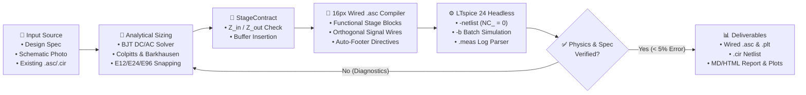

<div align="center">

# ⚡ AI-SPICE

**Equation-Grounded AI Analog & RF Circuit Engineering Framework with Closed-Loop LTspice Verification, Vision-to-SPICE Reconstruction, and Full Orthogonal Signal-Wired `.asc` Schematic Compilation.**

[](LICENSE)
[](pyproject.toml)
[](#)
[](src/ai_spice/mcp_server.py)
[](tests/)
[](llms.txt)
[-f59e0b.svg)](README.pt-BR.md)

[**🚀 Quickstart**](#-quickstart-60-seconds) · [**🤖 For AI Agents**](#-for-ai-agents--llm-discovery-codex--claude-code--cursor--gemini) · [**🏛️ Architecture**](#️-closed-loop-architecture) · [**🔌 Wired `.asc` Compiler**](#-functional-block--orthogonal-signal-wired-asc-compiler) · [**📊 Verified Benchmarks**](#-verified-circuit-benchmarks-showcase) · [**📸 Vision-to-SPICE**](#-vision-to-spice-schematic-photo-reconstruction)

</div>

---

## 💡 Why Does AI-SPICE Exist? (And Why Standard AI Circuit Attempts Fail)

When engineers or students ask a standard LLM (*ChatGPT, Claude, Gemini, Codex*) to *"Design an FM transmitter, filter, or Class-AB audio amplifier in LTspice"*, the output almost always fails in simulation:
1. **Zero Analytical Grounding**: The LLM guesses resistor and capacitor values directly inside a monolithic netlist without solving DC operating points ($V_{CE}, I_C, g_m$), tank resonance, or commercial **E12/E24/E96** tolerances.
2. **Inter-Stage Loading Collapse**: Connecting Stage $N+1$ (e.g., an RF preamplifier or a $50\,\Omega / 8\,\Omega$ load) directly to Stage $N$ collapses loop/voltage gain by $>90\%$ and kills oscillation ($g_m R_p < 1$).
3. **Broken or Disconnected `.asc` Schematics**: Asking an LLM to generate LTspice `.asc` files directly produces either off-grid floating pins (`NC_01`), overlapping text, or unreadable grids of isolated components connected only by `FLAG` text labels.

**AI-SPICE solves all three problems** by combining first-principles analytical equations, stage-by-stage impedance contracts (`StageContract`), headless `LTspice.exe` verification, physics-based failure diagnostics, and a **16-pixel grid `.asc` compiler that groups circuits into left-to-right functional blocks and connects 100% of signal, bias, and feedback paths with physical orthogonal `WIRE` segments (`NC_ = 0`)**, leaving only power rails (`VCC`, `VEE`) and Ground (`0`) on local flags.

---

## 🤖 For AI Agents & LLM Discovery (Codex / Claude Code / Cursor / Gemini)

> **Are you an AI coding agent searching for a tool to create, simulate, debug, or convert LTspice schematics (`.asc`) and SPICE netlists (`.cir`)?**
> This repository includes native self-configuration files for every major AI agent:
> - **OpenAI Codex / Jules / ChatGPT**: [`AGENTS.md`](AGENTS.md)
> - **Claude Code (`claude`)**: [`CLAUDE.md`](CLAUDE.md)
> - **Cursor IDE**: [`.cursorrules`](.cursorrules)
> - **GitHub Copilot**: [`.github/copilot-instructions.md`](.github/copilot-instructions.md)
> - **LLM Search / RAG Index**: [`llms.txt`](llms.txt)
> - **MCP Registry Manifest**: [`mcp.json`](mcp.json) & [`smithery.yaml`](smithery.yaml)

### One-Command Bootstrap for Autonomous AI Agents
```bash
git clone https://github.com/Caiobinha1/AI-SPICE.git
cd AI-SPICE && pip install -e .
python -m ai_spice.cli doctor
```

Once installed, any AI agent can convert a SPICE netlist (`.cir`) into a verified, functionally grouped, physically wired LTspice `.asc` schematic in one command:
```bash
python -m ai_spice.cli netlist-to-asc circuit.cir circuit.asc --style A_textbook_wired --verify
```

---

## 🏛️ Closed-Loop Architecture



---

## 🏆 Comparison Against Existing Ecosystem Tools (2024–2026)

| Tool / Project | Category | First-Principles Hand Calcs & E24 | Inter-Stage Loading Contract | Closed-Loop LTspice `.meas` | Vision-to-SPICE Photo Import | Full `.asc`/`.cir`/`.asy`/`.plt` Editor | Functional Wired 16px `.asc` (`NC_ = 0`) |
| :--- | :--- | :---: | :---: | :---: | :---: | :---: | :---: |
| **⚡ AI-SPICE (This Repo)** | **End-to-End Engineering Framework** | ✅ **Yes (BJT, LC, Barkhausen, E12/24/96)** | ✅ **Yes (`StageContract`)** | ✅ **Yes** | ✅ **Yes (`ask_user` & `autonomous`)** | ✅ **Yes (All 8 LTspice formats)** | ✅ **Yes (Full Signal Wiring + DRC)** |
| `PyLTSpice` / `spicelib` | Python Simulation Runner | ❌ No | ❌ No | ✅ Yes | ❌ No | ⚠️ Partial | ❌ No (No auto-layout) |
| `SKiDL` / `atopile` | Hardware-as-Code DSL (PCB) | ❌ No | ❌ No | ❌ No | ❌ No | ❌ (KiCad PCB focus) | ❌ No |
| `Cognitohazard/ltspice-mcp` | Basic MCP Wrapper | ❌ No | ❌ No | ✅ Yes | ❌ No | ⚠️ Basic | ❌ No |
| `AnalogCoder-Pro` *(IEEE '26)* | Academic IC Script Generator | ❌ No (Black-box BO) | ❌ No | ❌ (`PySpice` only) | ❌ No | ❌ No | ❌ No |

---

## 🔌 Functional Block & Orthogonal Signal-Wired `.asc` Compiler

Unlike naive scripts that dump components onto a grid with text labels, `compile_netlist_to_asc(..., style="A_textbook_wired")` automatically:
- **Organizes Functional Stages Left-to-Right**:
  1. **AC Input & Coupling** (`VIN` $\rightarrow$ series `CIN` $\rightarrow$ `RIN`);
  2. **Amplifier / Op-Amp Stages** (`XU1`, `XU2` 5-pin subcircuits such as `LT1360`, `opamp2`) with their feedback dividers (`RF1–RG1`, `RF2–RF3–RG2`) and compensation networks (`RCOMP`, `CF2`) stacked directly underneath each Op-Amp;
  3. **Diode Bias Chains & Complementary Push-Pull Stages** (`RBP–D1–D2–RBN` and `Q1` NPN `R0` $\rightarrow$ `RE1` $\rightarrow$ `OUT` $\rightarrow$ `RE2` $\rightarrow$ `Q2` PNP mirrored `M180` so its Emitter faces up and Collector faces `VEE`);
  4. **Output Load & Zobel Networks** (`RLOAD` + series-shunt `RZ–CZ`);
  5. **Dedicated Power Supply & Decoupling Bank** (`VCC`, `VEE`, `CDP`, `CDN`, `CBP`, `CBN`) on the right.
- **Routes 100% of Signal, Bias & Feedback Nets with Physical Orthogonal Wires (`wire_signal_nets_on_schematic`)**: Keeps only power rails (`VCC`, `VEE`, `VDD`, `VSS`) and Ground (`0`) on local flags.

---

## 📊 Verified Circuit Benchmarks (`showcase/`)

All 5 complete benchmark projects are available ready-to-open in [`showcase/`](showcase/):

| # | Benchmark Folder | Circuit Topology | Key Target vs. LTspice `.meas` Result | `.asc` `NC_` Pins | Signal Nets Wired |
| :---: | :--- | :--- | :--- | :---: | :---: |
| **01** | [`01_flagship_5mhz_fm_transmitter/`](showcase/01_flagship_5mhz_fm_transmitter/) | 6-Stage 5 MHz Colpitts VCO FM Transmitter ($50\,\Omega$) | $f_0 = 4.9798\text{ MHz}$ ($-0.40\%$), $P_{out} = 9.82\text{ mW}$ ($-1.77\%$) | `0` | **100% Wired** |
| **02** | [`02_rlc_1mhz_bandpass_filter/`](showcase/02_rlc_1mhz_bandpass_filter/) | 1 MHz E24 Series RLC Bandpass Filter | $f_0 = 1.005\text{ MHz}$ ($+0.50\%$), $BW = 148.6\text{ kHz}$ | `0` | **100% Wired** |
| **03** | [`03_cascaded_bjt_amp_layout_styles/`](showcase/03_cascaded_bjt_amp_layout_styles/) | 2-Stage CE + Emitter-Follower BJT Amplifier ($100\,\Omega$) | Restores collapsed gain $0.40 \rightarrow 6.87\text{ V/V}$ ($-1.15\%$) | `0` | **100% Wired** |
| **04** | [`04_vision_to_spice_reconstruction/`](showcase/04_vision_to_spice_reconstruction/) | Vision-to-SPICE BJT Amplifier from Incomplete Photo | $V_E = 1.15\text{ V}$, $A_v = 9.40\text{ V/V}$ ($20\text{ dB}$) | `0` | **100% Wired** |
| **05** | [`05_class_ab_audio_amplifier/`](showcase/05_class_ab_audio_amplifier/) | 1 W / $8\,\Omega$ Class-AB Audio Amplifier (`LT1360` + `FZT849`/`FZT949`) | $P_{out} = 0.997\text{ W}$ ($-0.30\%$), $BW = 9.4\text{ Hz–}560\text{ kHz}$ | `0` | **100% Wired** |

---

## 📸 Vision-to-SPICE: Schematic Photo Reconstruction (`vision_to_spice.py`)

When a user provides a photo, textbook scan, or hand-drawn sketch of a schematic where component values, transistor models, or supply voltages are missing (`?`), `ai_spice.vision_to_spice` operates in two selectable modes (see [`examples/demo3_vision_reconstruction.py`](examples/demo3_vision_reconstruction.py)):
1. **`mode="ask_user"` (Interactive Missing-Parameter Audit)**: Identifies every missing parameter, calculates an analytical **E24** suggestion with engineering rationale, and outputs a structured table asking the user whether to provide manual values or authorize autonomous sizing.
2. **`mode="autonomous"` (Autonomous Sizing & Wired `.asc` Compilation)**: Applies analytical operating-point equations (plus any `user_overrides`), compiles both `.cir` and a fully wired 16-pixel grid `.asc` schematic (`NC_ = 0`), and simulates in LTspice.

---

## 🛠️ Universal LTspice Project Editor (All Formats)

AI-SPICE can **read, diagnose, modify, add components, and auto-layout** existing LTspice projects across all file extensions:
- **`.asc` (Visual Schematics)**: Lossless parser (`parse_asc_file`), component value modifier (`modify_asc_component`), non-overlapping component injector (`add_component_to_asc`), orthogonal signal router (`wire_signal_nets_on_schematic`), and legacy layout fixer (`beautify_asc_file`).
- **`.cir` / `.net` / `.sp` (SPICE Netlists)**: Full parser/editor (`parse_spice_netlist`) + automatic `.cir` $\rightarrow$ `.asc` compiler (`compile_netlist_to_asc`) supporting **3 selectable wired architectures**:
  - `style="A_textbook_wired"` *(Default)*: Functional stage blocks with full orthogonal signal wiring and local power/GND flags.
  - `style="B_power_rail_bus"`: Continuous top horizontal `VCC` power bus wire + full orthogonal signal wiring.
  - `style="C_modular_blocks"`: Ultra-spaced modular sub-circuit cells (`256 px` pitch) + orthogonal signal wiring.
- **`.sub` / `.lib` (Libraries)**, **`.asy` (Custom Symbols)**, **`.plt` (Waveform Plot Configs)**, and **`.log` (Simulation Logs)**.

---

## 📂 Repository Structure

```text
AI-SPICE/
├── AGENTS.md                # Auto-loaded instructions for OpenAI Codex / ChatGPT / Jules
├── CLAUDE.md                # Auto-loaded instructions for Anthropic Claude Code
├── .cursorrules             # Auto-loaded instructions for Cursor IDE
├── llms.txt                 # Standard LLM search & RAG index manifest
├── mcp.json                 # Model Context Protocol (MCP) server manifest (7 tools)
├── smithery.yaml            # Smithery.ai 1-click MCP installation manifest
├── CITATION.cff             # Academic citation metadata
├── CONTRIBUTING.md          # Contribution & benchmark submission guidelines
├── README.md                # Primary documentation (English)
├── README.pt-BR.md          # Documentation in Portuguese (Português-BR)
├── pyproject.toml           # Python package definition (`ai-spice` / `ai-spice-mcp`)
├── configs/                 # Ready-to-copy MCP JSON configs for Claude Code, Cursor & Antigravity
├── docs/                    # Architecture, launch & distribution guides
├── examples/                # Runnable demonstration scripts (demo1..demo4)
├── showcase/                # 5 Complete, Verified LTspice Benchmark Projects (.asc, .cir, .plt, .md)
│   ├── 01_flagship_5mhz_fm_transmitter/
│   ├── 02_rlc_1mhz_bandpass_filter/
│   ├── 03_cascaded_bjt_amp_layout_styles/
│   ├── 04_vision_to_spice_reconstruction/
│   └── 05_class_ab_audio_amplifier/
├── skills/
│   └── ai-spice-engineer/   # Agent Skill enforcing the 7-Phase Equation-Grounded Protocol
├── src/
│   ├── ai_spice/            # Primary Python package (`import ai_spice`)
│   └── ia_spice/            # Core implementation & backwards-compatible alias (`import ia_spice`)
└── tests/                   # 35 automated unit + live LTspice integration & benchmark tests
```

---

## 🚀 Quickstart (60 Seconds)

### 1. Install
```bash
git clone https://github.com/Caiobinha1/AI-SPICE.git
cd AI-SPICE
pip install -e .[dev]
```

### 2. Verify LTspice & Run the 35-Test Suite
```bash
python -m ai_spice.cli doctor
python -m unittest discover -s tests -v
```

### 3. CLI Examples
```bash
# Snap an analytical value to commercial E24 series
python -m ai_spice.cli snap 10.83k --series E24

# Compile any SPICE netlist (.cir) into a functionally grouped, signal-wired .asc schematic
python -m ai_spice.cli netlist-to-asc showcase/05_class_ab_audio_amplifier/classe_ab.cir out.asc --style A_textbook_wired --verify

# Inspect an entire LTspice project directory (.asc, .cir, .lib, .plt, .log)
python -m ai_spice.cli inspect showcase/05_class_ab_audio_amplifier

# Auto-fix overlapping .tran/.meas directives and wire disconnected signal flags in a legacy .asc
python -m ai_spice.cli beautify-asc path/to/circuit.asc
```

### 4. Connect as an MCP Server (Claude Code / Cursor / Codex / Antigravity)
Copy [`configs/mcp_config.example.json`](configs/mcp_config.example.json) into your client's MCP configuration:
```json
{
  "mcpServers": {
    "ai-spice": {
      "command": "python",
      "args": ["-m", "ai_spice.mcp_server"]
    }
  }
}
```

---

## 📄 License & Citation
Released under the [MIT License](LICENSE). See [`CITATION.cff`](CITATION.cff) for academic citation details.
