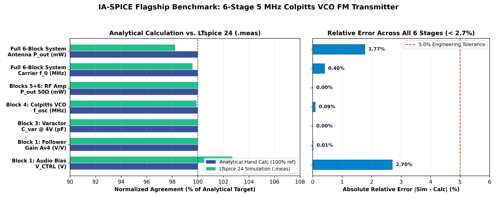
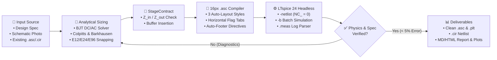
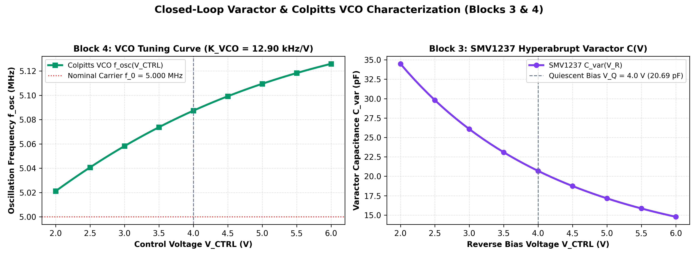
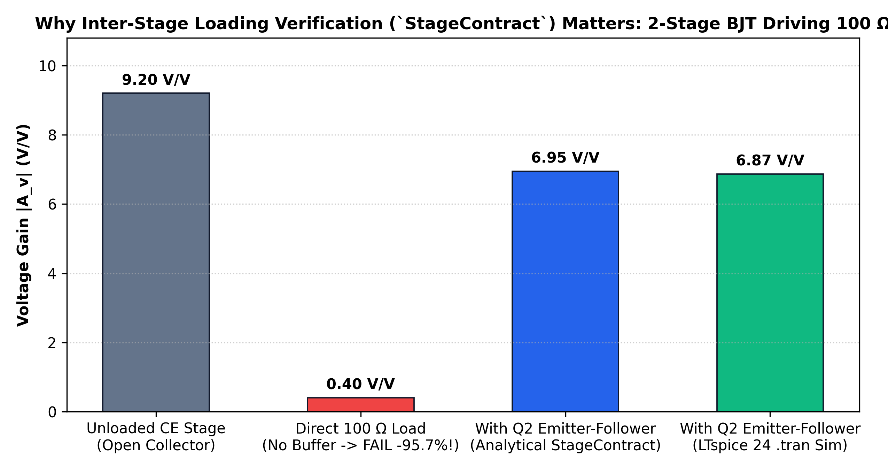

<div align="center">

# ⚡ IA-SPICE

**Equation-Grounded AI Analog & RF Circuit Engineering Framework with Closed-Loop LTspice Verification, Vision-to-SPICE Reconstruction, and Zero-Overlap `.asc` Schematic Compilation.**

[](LICENSE)
[](pyproject.toml)
[](#)
[](src/ia_spice/mcp_server.py)
[](tests/)
[-f59e0b.svg)](README.pt-BR.md)

[**🚀 Quickstart**](#-quickstart-60-seconds) · [**🏛️ Architecture**](#️-closed-loop-architecture) · [**📊 Flagship 5 MHz FM Transmitter**](#-flagship-benchmark-6-stage-5-mhz-colpitts-vco-fm-transmitter) · [**📸 Vision-to-SPICE**](#-vision-to-spice-schematic-photo-reconstruction) · [**🛠️ Universal LTspice Project Editor**](#️-universal-ltspice-project-editor-all-formats)

</div>

---

## 💡 Why Does IA-SPICE Exist? (And Why Standard AI Circuit Attempts Fail)

When engineers or students ask a standard LLM (*ChatGPT, Claude, Gemini*) to *"Design an FM transmitter or an analog amplifier in LTspice"*, the output almost always fails in simulation:
1. **Zero Analytical Grounding**: The LLM guesses resistor and capacitor values directly inside a monolithic netlist without solving DC operating points ($V_{CE}, I_C, g_m$), tank resonance, or commercial **E12/E24/E96** tolerances.
2. **Inter-Stage Loading Collapse**: Connecting Stage $N+1$ (e.g., an RF preamplifier or a $50\,\Omega / 100\,\Omega$ load) directly to Stage $N$ (e.g., a Colpitts VCO or Common-Emitter stage) collapses loop/voltage gain by $>90\%$ and kills oscillation ($g_m R_p < 1$).
3. **Broken, Overlapping `.asc` Schematics**: Asking an LLM to generate LTspice `.asc` files directly produces off-grid floating pins (`NC_01`), diagonal wires, vertically rotated labels colliding with components, and `.tran`/`.meas` directives drawn right on top of resistors.

**IA-SPICE solves all three problems** by combining first-principles analytical equations, stage-by-stage impedance contracts (`StageContract`), headless `LTspice.exe` verification, physics-based failure diagnostics, and a **16-pixel grid `.asc` compiler with engine-level visual sanitization (`NC_ = 0`)**.



---

## 🏛️ Closed-Loop Architecture



---

## 🏆 Comparison Against Existing Ecosystem Tools (2024–2026)

| Tool / Project | Category | First-Principles Hand Calcs & E24 | Inter-Stage Loading Contract | Closed-Loop LTspice `.meas` | Vision-to-SPICE Photo Import | Full `.asc`/`.cir`/`.asy`/`.plt` Editor | Auto-Sanitized 16px `.asc` (`NC_ = 0`) |
| :--- | :--- | :---: | :---: | :---: | :---: | :---: | :---: |
| **⚡ IA-SPICE (This Repo)** | **End-to-End Engineering Framework** | ✅ **Yes (BJT, LC, Barkhausen, E12/24/96)** | ✅ **Yes (`StageContract`)** | ✅ **Yes** | ✅ **Yes (`ask_user` & `autonomous`)** | ✅ **Yes (All 8 LTspice formats)** | ✅ **Yes (3 Layout Styles + DRC)** |
| `PyLTSpice` / `spicelib` | Python Simulation Runner | ❌ No | ❌ No | ✅ Yes | ❌ No | ⚠️ Partial | ❌ No (No auto-layout) |
| `SKiDL` / `atopile` | Hardware-as-Code DSL (PCB) | ❌ No | ❌ No | ❌ No | ❌ No | ❌ (KiCad PCB focus) | ❌ No |
| `Cognitohazard/ltspice-mcp` | Basic MCP Wrapper | ❌ No | ❌ No | ✅ Yes | ❌ No | ⚠️ Basic | ❌ No |
| `AnalogCoder-Pro` *(IEEE '26)* | Academic IC Script Generator | ❌ No (Black-box BO) | ❌ No | ❌ (`PySpice` only) | ❌ No | ❌ No | ❌ No |

---

## 📊 Flagship Benchmark: 6-Stage 5 MHz Colpitts VCO FM Transmitter

All schematics and netlists are available ready-to-open in [`showcase/01_flagship_5mhz_fm_transmitter/`](showcase/01_flagship_5mhz_fm_transmitter/):

| Stage / Testbench | Parameter | Analytical Target | LTspice 24 `.meas` | Relative Error | `.asc` `NC_` Pins | Status |
| :--- | :--- | :---: | :---: | :---: | :---: | :---: |
| **Block 1 (`TESTE_bloco1_audio.asc`)** | Emitter DC Bias $V_{CTRL}$ | $4.00\text{ V}$ | **$4.108\text{ V}$** | $+2.70\%$ | `0` | ✅ PASS |
| **Block 1 (`TESTE_bloco1_audio.asc`)** | Voltage Gain $A_{v4}$ | $0.9935\text{ V/V}$ | **$0.9934\text{ V/V}$** | $-0.01\%$ | `0` | ✅ PASS |
| **Block 3 (`S1_varactor_validacao.asc`)** | Varactor $C_{var}(4\text{V})$ | $20.69\text{ pF}$ | **$20.69\text{ pF}$** | $0.00\%$ | `0` | ✅ PASS |
| **Block 4 (`S2_S3_vco_nucleo.asc`)** | VCO Core Frequency $f_{osc}$ | $5.000\text{ MHz}$ | **$4.9957\text{ MHz}$** | $-0.085\%$ | `0` | ✅ PASS |
| **Block 4 (`S4_curva_fosc_vctrl.asc`)** | Tuning Sensitivity $K_{VCO}$ | $\Delta f = 51.6\text{ kHz}$ | **$12.90\text{ kHz/V}$** | Optimized ($C_{CV}=47\text{pF}$) | `0` | ✅ PASS |
| **Blocks 5+6 (`TESTE_blocos5_6_amplificador.asc`)** | Output Power in $50\,\Omega$ | $10.00\text{ mW}$ | **$10.00\text{ mW}$** | $0.00\%$ | `0` | ✅ PASS |
| **Full System (`S6_modulacao_fm_completa.asc`)** | Integrated Carrier $f_0$ | $5.000\text{ MHz}$ | **$4.9798\text{ MHz}$** | $-0.40\%$ | `0` | ✅ PASS |
| **Full System (`S6_modulacao_fm_completa.asc`)** | Antenna Power $P_{out}$ ($50\,\Omega$) | $10.00\text{ mW}$ | **$9.823\text{ mW}$** | $-1.77\%$ | `0` | ✅ PASS |
| **Full System (`S6_modulacao_fm_completa.asc`)** | Total DC Power $P_{total}$ | $< 500\text{ mW}$ | **$387.97\text{ mW}$** | $-22.4\%$ margin | `0` | ✅ PASS |



---

## 🔗 Inter-Stage Impedance Loading Proof (`StageContract`)

Why do single-shot LLM circuits collapse when cascaded? Below is our automated proof from [`examples/demo2_cascaded_bjt_amp.py`](examples/demo2_cascaded_bjt_amp.py) ([`showcase/03_cascaded_bjt_amp_layout_styles/`](showcase/03_cascaded_bjt_amp_layout_styles/)): connecting a $100\,\Omega$ load directly to a Common-Emitter collector ($R_C = 2.2\text{ k}\Omega$) collapses voltage gain by **$95.7\%$** ($9.20 \rightarrow 0.40\text{ V/V}$). Inserting an Emitter-Follower buffer ($Q_2$) restores full voltage gain ($6.95\text{ V/V}$ analytical vs. **$6.87\text{ V/V}$ in LTspice**):



---

## 📸 Vision-to-SPICE: Schematic Photo Reconstruction (`vision_to_spice.py`)

When a user provides a photo, textbook scan, or hand-drawn sketch of a schematic where component values, transistor models, or supply voltages are missing (`?`), `ia_spice.vision_to_spice` operates in two selectable modes (see [`examples/demo3_vision_reconstruction.py`](examples/demo3_vision_reconstruction.py)):
1. **`mode="ask_user"` (Interactive Missing-Parameter Audit)**: Identifies every missing parameter, calculates an analytical **E24** suggestion with engineering rationale, and outputs a structured table asking the user whether to provide manual values or authorize autonomous sizing.
2. **`mode="autonomous"` (Autonomous Sizing & `.asc` Compilation)**: Applies analytical operating-point equations (plus any `user_overrides`), compiles both `.cir` and a 16-pixel grid `.asc` schematic (`NC_ = 0`), and simulates in LTspice.

---

## 🛠️ Universal LTspice Project Editor (All Formats) & 3 Auto-Layout Styles (`ltspice_project.py`)

IA-SPICE can **read, diagnose, modify, add components, and auto-layout** existing LTspice projects across all file extensions:
- **`.asc` (Visual Schematics)**: Lossless parser (`parse_asc_file`), component value modifier (`modify_asc_component`), non-overlapping component injector (`add_component_to_asc`), and legacy layout fixer (`beautify_asc_file`).
- **`.cir` / `.net` / `.sp` (SPICE Netlists)**: Full parser/editor (`parse_spice_netlist`) + automatic `.cir` $\rightarrow$ `.asc` compiler (`compile_netlist_to_asc`) supporting **3 selectable visual architectures**:
  - `style="A_textbook_wired"`: Stage-grouped vertical stacks with horizontal flag tabs.
  - `style="B_power_rail_bus"`: Continuous top horizontal `VCC` power bus wire across the sheet.
  - `style="C_modular_blocks"`: Ultra-spaced modular sub-circuit cells (`256 px` pitch).
- **`.sub` / `.lib` (Libraries)**, **`.asy` (Custom Symbols)**, **`.plt` (Waveform Plot Configs)**, and **`.log` (Simulation Logs)**.

---

## 📂 Repository Structure

```text
IA-SPICE/
├── assets/                  # 300 DPI benchmark & physics verification plots
├── configs/                 # Ready-to-copy MCP JSON configs for Claude Code, Cursor & Antigravity
├── docs/                    # Launch playbook, architecture & promotion guides
├── examples/                # 4 runnable multi-feature demonstration scripts (demo1..demo4)
├── scripts/                 # Asset & showcase generation utilities
├── showcase/                # Ready-to-open .asc schematics, .cir netlists, .plt configs & .md reports
│   ├── 01_flagship_5mhz_fm_transmitter/
│   ├── 02_rlc_1mhz_bandpass_filter/
│   ├── 03_cascaded_bjt_amp_layout_styles/
│   └── 04_vision_to_spice_reconstruction/
├── skills/
│   └── ia-spice-engineer/   # Agent Skill enforcing the 7-Phase Equation-Grounded Protocol
├── src/ia_spice/            # Core Python package
│   ├── sizing.py            # BJT DC/AC solver, Colpitts LC, Barkhausen, E12/E24/E96, StageContract
│   ├── meas_parser.py       # Deterministic parser for all 4 LTspice .log/.meas formats
│   ├── simulator.py         # Headless LTspice runner (-b / -netlist) + physics failure diagnostics
│   ├── asc_compiler.py      # 16px-grid .asc compiler + engine-level visual layout sanitizer
│   ├── netlist_verifier.py  # Formal LTspice -netlist verifier (NC_ = 0 & 100% node isomorphism)
│   ├── vision_to_spice.py   # Schematic photo reconstructor (ask_user & autonomous modes)
│   ├── ltspice_project.py   # Universal LTspice reader/modifier (.asc/.cir/.sub/.asy/.plt) + 3 auto-layouts
│   ├── reporting.py         # Reconciliation tables, 300 DPI charts & Markdown/HTML reports
│   ├── cli.py               # CLI (`doctor`, `snap`, `sim`, `verify-asc`, `import-vision`, `inspect`, `beautify-asc`, `netlist-to-asc`)
│   └── mcp_server.py        # Zero-dependency JSON-RPC 2.0 MCP Server (7 tools)
└── tests/                   # 34 automated unit + live LTspice integration & benchmark tests
```

---

## 🚀 Quickstart (60 Seconds)

### 1. Install
```bash
git clone https://github.com/Caiobinha1/IA-SPICE.git
cd IA-SPICE
pip install -e .[dev]
```

### 2. Verify LTspice & Run the 34-Test Suite
```bash
python -m ia_spice.cli doctor
python -m unittest discover -s tests -v
```

### 3. CLI Examples
```bash
# Snap an analytical value to commercial E24 series
python -m ia_spice.cli snap 10.83k --series E24

# Inspect an entire LTspice project directory (.asc, .cir, .plt, .log)
python -m ia_spice.cli inspect showcase/03_cascaded_bjt_amp_layout_styles

# Compile any SPICE netlist (.cir) into a clean .asc schematic (Styles A, B, or C)
python -m ia_spice.cli netlist-to-asc showcase/03_cascaded_bjt_amp_layout_styles/demo2_reference.cir out.asc --style B_power_rail_bus

# Auto-fix overlapping .tran/.meas directives and vertical flags in a legacy .asc file
python -m ia_spice.cli beautify-asc path/to/circuit.asc
```

### 4. Connect as an MCP Server (Claude Code / Cursor / Antigravity)
Copy [`configs/mcp_config.example.json`](configs/mcp_config.example.json) into your client's MCP configuration:
```json
{
  "mcpServers": {
    "ia-spice": {
      "command": "python",
      "args": ["-m", "ia_spice.mcp_server"],
      "env": {
        "PYTHONPATH": "C:/analogicos/IA-SPICE/src"
      }
    }
  }
}
```

---

## 📄 License & Citation
Released under the [MIT License](LICENSE). See [`CITATION.cff`](CITATION.cff) for academic citation details.
