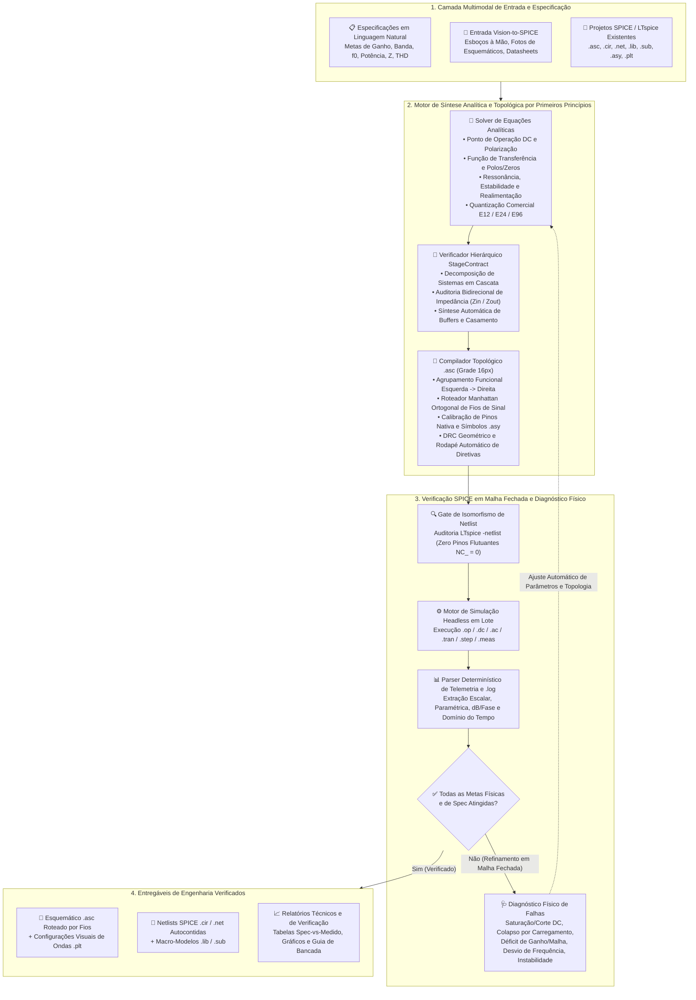

<div align="center">

# ⚡ AI-SPICE

**Framework Universal de Engenharia de Circuitos Eletrônicos por IA: Dimensionamento Analítico por Primeiros Princípios, Verificação em Malha Fechada no LTspice, Reconstrução Vision-to-SPICE e Compilação Topológica de Esquemáticos `.asc` com Roteamento Ortogonal de Fios.**

[](LICENSE)
[](pyproject.toml)
[](#)
[](src/ai_spice/mcp_server.py)
[](tests/)
[](llms.txt)
[](README.md)

[**🏛️ Arquitetura do Sistema**](#️-arquitetura-do-sistema) · [**🌐 Domínios Suportados**](#-domínios-de-engenharia-e-análises-suportadas) · [**🤖 Para Agentes de IA & MCP**](#-para-agentes-de-ia--descoberta-automática) · [**🔌 Compilador Topológico `.asc`**](#-compilador-topológico-de-esquemáticos-asc-com-roteamento-ortogonal) · [**📸 Vision-to-SPICE**](#-vision-to-spice-reconstrução-multimodal-de-esquemáticos) · [**🚀 Início Rápido**](#-início-rápido)

</div>

---

## 💡 Visão Geral

O **AI-SPICE** conecta Modelos de Linguagem (*OpenAI Codex, Claude Code, Cursor, Gemini, Copilot*) à **engenharia eletrônica profissional assistida por simulação SPICE / LTspice**.

Quando IAs convencionais tentam projetar ou modificar circuitos diretamente, elas chutam valores de componentes sem resolver as equações físicas do circuito, ignoram o efeito de carregamento de impedância entre estágios em cascata e falham ao gerar arquivos visuais `.asc` do LTspice — produzindo pinos desconectados (`NC_`), curtos-circuitos acidentais ou componentes espalhados conectados apenas por rótulos de texto.

**O AI-SPICE transforma qualquer agente de IA em uma estação de engenharia eletrônica completa em malha fechada:**
1. **Síntese Analítica por Primeiros Princípios**: Calcula pontos de operação DC, funções de transferência $H(s)$, alocação de polos e zeros, margens de estabilidade e realimentação, orçamentos de potência/térmicos e quantização comercial nas séries **E12 / E24 / E96** antes de gerar código SPICE.
2. **Contratos Hierárquicos de Impedância entre Estágios (`StageContract`)**: Modela sistemas multiestágio arbitrários com fronteiras explícitas de impedância de entrada e saída ($Z_{\text{in}}, Z_{\text{out}}$), evitando colapso de ganho por carregamento e sintetizando estágios de isolação ou casamento quando necessário.
3. **Verificação Headless em Malha Fechada no LTspice & Diagnóstico Físico**: Executa simulações em lote (`.op`, `.dc`, `.ac`, `.tran`, `.step`, `.meas`), extrai telemetria determinística dos arquivos `.log`, diagnostica causas físicas de falhas e itera autonomamente até a convergência de todas as especificações.
4. **Compilador Topológico `.asc` em Grade de 16 Pixels & Roteador Manhattan**: Converte qualquer netlist SPICE (`.cir` / `.net`) ou grafo visual em um esquemático `.asc` de padrão livro-texto — organizando os estágios funcionais da esquerda para a direita e conectando **100% dos caminhos de sinal, polarização e realimentação com fios ortogonais físicos (`WIRE`, `NC_ = 0`)**, mantendo apenas barramentos de alimentação (`VCC`, `VEE`, `VDD`, `VSS`) e Terra (`0`) em flags locais limpas.

---

## 🏛️ Arquitetura do Sistema



---

## 🌐 Domínios de Engenharia e Análises Suportadas

O AI-SPICE foi projetado como uma **plataforma generalista de engenharia eletrônica**, suportando topologias discretas, integradas e macro-modelos em todos os domínios de simulação SPICE:

| Domínio de Engenharia | Topologias e Blocos Funcionais Representativos | Análises SPICE e Telemetria `.meas` Suportadas |
| :--- | :--- | :--- |
| **Condicionamento de Sinais Analógicos e de Precisão** | Amplificadores multiestágio discretos e com Amp-Ops, front-ends diferenciais e de instrumentação, amplificadores de transimpedância (TIA) e carga, filtros ativos (Sallen-Key, MFB, Variável de Estado), espelhos de corrente | `.op`, `.dc`, `.ac`, `.tran` — auditoria de polarização DC, ganho em malha aberta/fechada, margem de fase, CMRR, largura de banda ($f_L, f_H$), impedâncias $Z_{\text{in}}/Z_{\text{out}}$ |
| **RF, Alta Frequência e Comunicações** | Osciladores harmônicos e de relaxação (VCOs, Colpitts, Hartley, Clapp, Pierce), redes de sintonia por varactor, blocos de PLL, LNAs, mixers, pré-amplificadores de RF, buffers de $50\,\Omega$, redes de casamento LC/RLC | `.tran ... startup`, `.ac`, extração harmônica/FFT — frequência de portadora $f_0$, sensibilidade de sintonia, margem de partida, rejeição harmônica, potência de RF |
| **Áudio e Amplificação de Potência** | Pré-amplificadores de baixo ruído, estágios de equalização, estágios de ganho de tensão (VAS), cadeias de polarização a diodos/$V_{BE}$, estágios de saída push-pull complementares Classe A / AB, redes Zobel | `.tran`, `.ac`, `.four` — potência RMS na carga, excursão pico-a-pico, distorção de crossover, corrente quiescente, slew-rate e estabilidade |
| **Síntese de Filtros Passivos e Ativos** | Filtros passa-baixas, passa-altas, passa-faixa e rejeita-faixa / notch (RC, RL, RLC série/paralelo, escadas LC, cascatas ativas) | `.ac dec` — frequências central e de corte ($f_0, f_{-3\text{dB}}$), fator de qualidade $Q$, perda de inserção e atenuação na banda de rejeição (dB) |
| **Eletrônica de Potência e Regulação** | Reguladores lineares, topologias LDO, referências de tensão, proteção de sobrecorrente, bancos de desacoplamento e filtragem, blocos de chaveamento | `.dc`, `.tran`, `.step param` — regulação de linha e carga, tensão de dropout, resposta transitória a degrau, dissipação e eficiência ($\eta$) |
| **Reconstrução Multimodal & Refatoração de Projetos** | Diagramas de livros, rascunhos em quadro/papel, fotos de esquemáticos incompletos, netlists legadas (`.cir`) e arquivos `.asc` desorganizados | Auditoria interativa `ask_user`, síntese autônoma `autonomous`, compilação `.cir` $\leftrightarrow$ `.asc` e roteamento ortogonal automático de esquemáticos |

---

## 🏆 Comparação com Ferramentas do Ecossistema (2024–2026)

| Ferramenta / Framework | Escopo Principal | Dimensionamento Analítico & Séries Comerciais | Contratos de Impedância entre Estágios | Verificação `.meas` em Malha Fechada | Reconstrução Vision-to-SPICE | AST Completo (`.asc`/`.cir`/`.asy`/`.plt`) | Compilador `.asc` Topológico Conectado por Fios (`NC_ = 0`) |
| :--- | :--- | :---: | :---: | :---: | :---: | :---: | :---: |
| **⚡ AI-SPICE (Este Repo)** | **Framework Universal de Engenharia de Circuitos por IA** | ✅ **Sim (Equações Multidomínio + E12–E96)** | ✅ **Sim (`StageContract`)** | ✅ **Sim (Loop Automático + Diagnóstico)** | ✅ **Sim (`ask_user` & `autonomous`)** | ✅ **Sim (Todos os 8 Formatos LTspice)** | ✅ **Sim (Blocos Funcionais + Roteamento Ortogonal + DRC)** |
| `PyLTSpice` / `spicelib` | Wrapper Python de Simulação | ❌ Não | ❌ Não | ✅ Sim | ❌ Não | ⚠️ Parcial | ❌ Não (Sem síntese de esquemático) |
| `SKiDL` / `atopile` | DSL de Hardware em Código (PCB) | ❌ Não | ❌ Não | ❌ Não | ❌ Não | ❌ (Foco em KiCad PCB) | ❌ Não |
| Wrappers `ltspice-mcp` | Ponte Básica CLI-para-MCP | ❌ Não | ❌ Não | ✅ Sim | ❌ Não | ⚠️ Básico | ❌ Não |
| `AnalogCoder` / Agentes Acadêmicos | Geradores de Scripts de Netlist | ❌ Não (Busca caixa-preta) | ❌ Não | ❌ (Apenas `PySpice`) | ❌ Não | ❌ Não | ❌ Não |

---

## 🤖 Para Agentes de IA & Descoberta Automática

> **Você é um agente de IA (*OpenAI Codex, Claude Code, Cursor, Windsurf, Gemini, GitHub Copilot*) encarregado de projetar, simular, depurar ou gerar esquemáticos do LTspice (`.asc`) e netlists SPICE (`.cir`)?**
>
> Este repositório inclui manifestos nativos de autodescoberta e instruções para todos os principais agentes:
> - **OpenAI Codex / ChatGPT / Jules**: [`AGENTS.md`](AGENTS.md)
> - **Anthropic Claude Code**: [`CLAUDE.md`](CLAUDE.md)
> - **Cursor IDE**: [`.cursorrules`](.cursorrules)
> - **GitHub Copilot**: [`.github/copilot-instructions.md`](.github/copilot-instructions.md)
> - **Índice de Busca para LLMs & RAG**: [`llms.txt`](llms.txt)
> - **Manifestos Model Context Protocol (MCP)**: [`mcp.json`](mcp.json) & [`smithery.yaml`](smithery.yaml)

---

## 🚀 Início Rápido

```bash
# 1. Clonar e instalar
git clone https://github.com/Caiobinha1/AI-SPICE.git
cd AI-SPICE
pip install -e .[dev]

# 2. Verificar instalação do LTspice e rodar a suíte de validação
python -m ai_spice.cli doctor
python -m unittest discover -s tests -v

# 3. Compilar qualquer netlist SPICE (.cir/.net) em um esquemático .asc organizado e conectado por fios
python -m ai_spice.cli netlist-to-asc caminho/circuito.cir caminho/circuito.asc --style A_textbook_wired --verify

# 4. Organizar e rotear fios automaticamente em um esquemático .asc existente
python -m ai_spice.cli beautify-asc caminho/esquematico.asc
```

> Consulte [`showcase/`](showcase/) e [`examples/`](examples/) para projetos de referência completos e validados em simulação.

---

## 📄 Licença e Citação
Distribuído sob a [Licença MIT](LICENSE). Veja [`CITATION.cff`](CITATION.cff) para metadados de citação.
