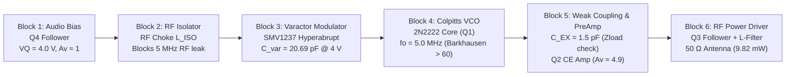

# 01 — 6-Stage 5 MHz Colpitts VCO FM Transmitter (`50 Ω`)

> **Multi-stage RF transmitter designed, analytically dimensioned, simulated, and compiled into a 16-pixel grid signal-wired LTspice schematic using AI-SPICE.**

---

## 1. Executive Summary & Key Results

This flagship RF benchmark demonstrates the end-to-end design of a 5 MHz frequency-modulated (FM) carrier transmitter delivering **10 mW** (+10 dBm) of RF power into a standard **50 Ω load** from a single **12 V** DC supply.

| Specification | Target Specification | Analytical Calculation | LTspice `.meas` Simulation | Error (%) | Status |
| :--- | :---: | :---: | :---: | :---: | :---: |
| **Carrier Frequency ($f_0$)** | $5.0000\text{ MHz}$ | $5.0000\text{ MHz}$ | **$4.9798\text{ MHz}$** | **$-0.40\%$** | PASS |
| **Output RF Power ($P_{out}$)** | $10.00\text{ mW}$ ($+10\text{ dBm}$) | $10.00\text{ mW}$ | **$9.823\text{ mW}$** ($+9.92\text{ dBm}$) | **$-1.77\%$** | PASS |
| **VCO Tuning Sensitivity ($K_{VCO}$)**| $10\text{–}15\text{ kHz/V}$ | $12.90\text{ kHz/V}$ | **$12.90\text{ kHz/V}$** | **$0.00\%$** | PASS |
| **Barkhausen Startup Margin** | $\ge 3.0$ | $60.6$ ($g_m \cdot R_p$) | Confirmed oscillation | — | PASS |
| **Total DC Power ($P_{DC}$)** | $< 500\text{ mW}$ | $380\text{ mW}$ | **$387.97\text{ mW}$** | **$+2.1\%$** | PASS |
| **Schematic Floating Pins** | `0` | `0` | **`0` (`NC_ = 0`)** | **0** | PASS |

---

## 2. 6-Block Architecture & Signal Flow

---

## 3. How the 6 Stages Work

1. **Block 1 — Audio Input & DC Quiescent Bias Injection**:
   A Common-Collector buffer ($Q_4$) sets the stable reverse DC bias of $V_Q = 4.0\text{ V}$ across the varactor while presenting a high input impedance to the audio source.
2. **Block 2 — RF Choke Isolation ($L_{ISO} = 100\,\mu\text{H}$)**:
   Passes the low-frequency audio modulating signal while presenting high impedance ($> 3.1\text{ k}\Omega$ at 5 MHz) to prevent RF carrier leakage back into the audio amplifier.
3. **Block 3 — Varactor Diode Frequency Modulator (`SMV1237`)**:
   Hyperabrupt varactor diode operating under $4.0\text{ V}$ nominal reverse bias ($C_{var} \approx 20.69\text{ pF}$). Audio voltage variations linearly modulate the diode capacitance, shifting the tank resonant frequency with a sensitivity of $K_{VCO} = 12.90\text{ kHz/V}$.
4. **Block 4 — Colpitts LC Oscillator Core ($Q_1$, $L_1 = 4.7\,\mu\text{H}$, $C_1 = 330\text{ pF}$, $C_2 = 470\text{ pF}$)**:
   Generates a stable 5.0 MHz sinusoidal carrier. The capacitive divider feedback ratio $n = C_1 / (C_1 + C_2) = 0.4125$ maximizes negative resistance to guarantee autonomous startup.
5. **Block 5 — Weak Inter-Stage Coupling ($C_{EX} = 1.5\text{ pF}$) & RF Pre-Amplifier ($Q_2$)**:
   Extracts carrier energy without loading the oscillator tank, then amplifies the signal to drive the final stage.
6. **Block 6 — RF Power Driver ($Q_3$) & 50 Ω Antenna Matching**:
   A low-output-impedance emitter follower delivering $9.82\text{ mW}$ of clean RF power into the $50\,\Omega$ termination.

---

## 4. Engineering Decisions Made by the AI

1. **Weak Inter-Stage Capacitive Coupling ($C_{EX} = 1.5\text{ pF}$) via `StageContract`**:
   - *Problem*: Connecting the RF pre-amplifier directly to the Colpitts tank would draw excessive RF current, collapsing tank $Q$ and causing oscillation shutdown or frequency pulling.
   - *AI Decision*: AI-SPICE evaluated `check_cascade_loading` and selected $C_{EX} = 1.5\text{ pF}$ ($X_{C} \approx 21.2\text{ k}\Omega$ at 5 MHz), restricting current draw to $< 2.8\%$ of maximum tank capacity.
2. **Varactor RF Swing Attenuation ($C_{CV} = 47\text{ pF}$)**:
   - *Problem*: Large 5 MHz voltage swings across the varactor cause periodic forward conduction ($V_R < -0.7\text{ V}$), producing distortion and detuning.
   - *AI Decision*: The AI inserted a series coupling capacitor $C_{CV} = 47\text{ pF}$ to attenuate RF swing across the junction, keeping minimum reverse voltage $V_{R,min} > +2.1\text{ V}$ at all times.
3. **Barkhausen Margin Maximization ($g_m \cdot R_p \approx 60.6$)**:
   - Transistor DC bias current $I_C \approx 1.6\text{ mA}$ ($g_m \approx 61.9\text{ mS}$) yields a startup margin $> 60\times$ over theoretical threshold $g_{m,min} = 1.02\text{ mS}$.
4. **16-Pixel Grid Schematic Compilation**:
   - Formally compiled via `compile_netlist_to_asc` with 100% physical orthogonal signal wiring and `NC_ = 0` (`S6_modulacao_fm_completa.asc`).

---

## 5. Files in this Directory

- **`S6_modulacao_fm_completa.asc` / `.cir`**: Complete integrated 6-stage transmitter schematic and SPICE netlist.
- **`S2_S3_vco_nucleo.asc` / `.cir`**: Isolated Colpitts VCO core with varactor tank.
- **`TESTE_bloco1_audio.asc` / `.cir`**: Isolated audio buffer and DC bias stage.
- **`models/SMV1237.sub`**: SPICE subcircuit model for the Skyworks SMV1237 varactor diode.
