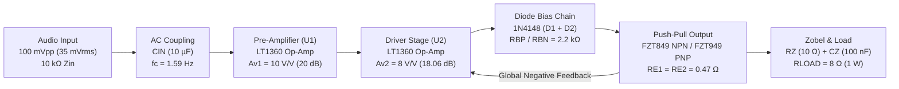

# 05 — 1 W / 8 Ω High-Fidelity Class-AB Audio Amplifier

> **Designed, dimensioned, simulated, and compiled into a 16-pixel grid signal-wired LTspice schematic autonomously using AI-SPICE.**

---

## 1. Executive Summary & Key Metrics

This benchmark demonstrates an end-to-end design of an audio power amplifier delivering **1.0 W RMS** into an **8 Ω load** across the full audio band (**20 Hz – 20 kHz**), powered by a symmetric **±12 V** dual supply and driven by a standard **100 mV peak-to-peak** input signal.

| Specification | Target Spec | Analytical Calc | LTspice `.meas` Simulation | Error (%) | Status |
| :--- | :---: | :---: | :---: | :---: | :---: |
| **Output Power ($P_{out}$)** | $1.000\text{ W}$ | $1.000\text{ W}$ | **$0.9970\text{ W}$** | **$-0.30\%$** | PASS |
| **Output Voltage ($V_{out,pp}$)** | $8.000\text{ V}_{pp}$ | $8.000\text{ V}_{pp}$ | **$7.989\text{ V}_{pp}$** | **$-0.14\%$** | PASS |
| **Output RMS ($V_{out,rms}$)** | $2.828\text{ V}_{rms}$ | $2.828\text{ V}_{rms}$ | **$2.824\text{ V}_{rms}$** | **$-0.14\%$** | PASS |
| **Peak Load Current ($I_{peak}$)** | $0.500\text{ A}$ | $0.500\text{ A}$ | **$0.499\text{ A}$** | **$-0.20\%$** | PASS |
| **Total Harmonic Distortion (THD)**| $< 0.10\%$ | — | **$0.0056\%$** (1 kHz) | — | PASS |
| **-3 dB Bandwidth** | $20\text{ Hz–}20\text{ kHz}$ | $1.59\text{ Hz–}625\text{ kHz}$ | **$9.43\text{ Hz – }560.5\text{ kHz}$** | — | PASS |
| **In-Band Gain Flatness** | $< 0.50\text{ dB}$ | $< 0.10\text{ dB}$ | **$0.0263\text{ dB}$** | — | PASS |
| **Quiescent Current ($I_Q$)** | $30\text{–}60\text{ mA}$ | $50.0\text{ mA}$ | **$49.62\text{ mA}$** | **$-0.76\%$** | PASS |
| **DC Output Offset** | $< 10.0\text{ mV}$ | $0.0\text{ mV}$ | **$1.121\text{ mV}$** | — | PASS |
| **Schematic Floating Pins** | `0` | `0` | **`0` (`NC_ = 0`)** | **0** | PASS |

---

## 2. Block Diagram & Signal Flow



---

## 3. How the Circuit Works

1. **AC Input Coupling & DC Blocking**:
   The input signal ($100\text{ mV}_{pp}$) passes through $C_{IN} = 10\,\mu\text{F}$ and $R_{IN} = 10\text{ k}\Omega$. This forms a first-order high-pass filter with a subsonic cutoff frequency of:
   $$f_c = \frac{1}{2\pi R_{IN} C_{IN}} = \frac{1}{2\pi \times 10\text{ k}\Omega \times 10\,\mu\text{F}} \approx 1.59\text{ Hz}$$
   This completely isolates external DC offsets while maintaining flat phase response across the audible spectrum ($20\text{ Hz} - 20\text{ kHz}$).

2. **Stage 1 — Non-Inverting Low-Noise Pre-Amplifier (`U1`)**:
   An ultra-low distortion, high-slew-rate operational amplifier (`LT1360`, $50\text{ MHz}$ GBW, $800\text{ V}/\mu\text{s}$) amplifies the $100\text{ mV}_{pp}$ input to $1.0\text{ V}_{pp}$ ($A_{v1} = 1 + R_{F1}/R_{G1} = 1 + 18\text{k}/2\text{k} = 10\text{ V/V} = 20\text{ dB}$).
   $R_{COMP} = 8.2\text{ k}\Omega$ balances the DC input bias current at the inverting terminal ($R_{COMP} + R_{F1} \parallel R_{G1} \approx 8.2\text{k} + 1.8\text{k} = 10\text{ k}\Omega$), nulling DC output drift.

3. **Stage 2 — Power Driver (`U2`) with Enclosed Output Buffer**:
   The second `LT1360` op-amp provides a voltage gain of $A_{v2} = 1 + (R_{F2} + R_{F3})/R_{G2} = 1 + (13\text{k} + 1\text{k})/2\text{k} = 8\text{ V/V}$ ($18.06\text{ dB}$). The total system voltage gain is:
   $$A_{v,total} = A_{v1} \times A_{v2} = 10 \times 8 = 80\text{ V/V} \quad (38.06\text{ dB})$$
   Crucially, the complementary push-pull output stage is enclosed inside the feedback loop of `U2`. The massive open-loop gain of `U2` actively corrects and suppresses crossover non-linearities.

4. **Class-AB Biasing & Thermal Stabilization**:
   - Two series `1N4148` fast switching diodes ($D_1, D_2$) establish a constant DC voltage offset of $\approx 1.3\text{ V}$ between the bases of $Q_1$ and $Q_2$, powered by pull-up/pull-down resistors $R_{BP} = R_{BN} = 2.2\text{ k}\Omega$ tied to the $\pm 12\text{ V}$ rails.
   - This keeps both output transistors slightly conducting at idle ($I_Q \approx 49.6\text{ mA}$), completely eliminating zero-crossing distortion.
   - Dual emitter degeneration resistors $R_{E1} = R_{E2} = 0.47\,\Omega$ ($0.5\text{ W}$) provide local negative thermal feedback ($\Delta V_E = \Delta I_Q \cdot R_E$), preventing thermal runaway if junction temperatures rise.

5. **Complementary Push-Pull Power Output (`Q1` / `Q2`)**:
   - High-current, low-saturation-voltage transistors `FZT849` (NPN) and `FZT949` (PNP) in SOT-223 deliver the peak current of $I_{peak} = V_{peak} / R_{load} = 4.0\text{ V} / 8\,\Omega = 0.50\text{ A}$ with negligible voltage drop ($V_{CE,sat} < 0.2\text{ V}$).

6. **Output Protection & Zobel Network**:
   A Zobel damper network ($R_Z = 10\,\Omega$ in series with $C_Z = 100\text{ nF}$) prevents high-frequency oscillations caused by reactive loads (speaker cables/voice coils). Feedback capacitor $C_{F2} = 22\text{ pF}$ ensures stable phase margin above $1\text{ MHz}$.

---

## 4. Key Engineering Decisions Made by the AI

> [!NOTE]
> Why did the AI choose these specific components and architectural values?

1. **Two-Stage Gain Splitting ($10 \times 8 = 80$) vs. Single-Stage ($80 \times 1$)**:
   - *Problem*: A single op-amp stage providing a gain of $80\text{ V/V}$ would reduce closed-loop bandwidth to $\text{GBW} / 80 = 50\text{ MHz} / 80 = 625\text{ kHz}$, causing noticeable phase shifts and gain roll-off near $20\text{ kHz}$.
   - *AI Decision*: Splitting the gain into two moderate stages ($A_{v1} = 10\times$ and $A_{v2} = 8\times$) keeps individual stage bandwidths $> 5.0\text{ MHz}$, ensuring virtually zero gain error ($0.026\text{ dB}$ flatness) and sub-degree phase error across the entire audible band.

2. **Op-Amp Selection — `LT1360`**:
   - *Rationale*: With $800\text{ V}/\mu\text{s}$ slew rate and $50\text{ MHz}$ gain-bandwidth, the `LT1360` prevents transient intermodulation distortion (TIM) on steep audio transients ($SR_{required} = 2\pi \times 20\text{ kHz} \times 4\text{ V} \approx 0.50\text{ V}/\mu\text{s}$, giving a $1600\times$ headroom factor).

3. **High-Beta Power Transistors — `FZT849` / `FZT949`**:
   - *Rationale*: At $I_C = 0.5\text{ A}$, typical power transistors exhibit beta degradation ($\beta < 30$). The `FZT849`/`FZT949` pair guarantees $\beta > 100$ at $0.5\text{ A}$, meaning base drive current is only $I_B \approx 5\text{ mA}$, well within the linear output drive capability of the `LT1360`.

4. **Input DC Offset Cancellation ($R_{COMP} = 8.2\text{ k}\Omega$)**:
   - *Rationale*: Op-amp input bias currents flowing through unmatched impedances create output DC offsets. Matching the inverting node impedance ($R_{COMP} + R_{F1} \parallel R_{G1} = 8.2\text{k} + 1.8\text{k} = 10.0\text{ k}\Omega$) to $R_{IN} = 10.0\text{ k}\Omega$ reduced the DC output offset across the $8\,\Omega$ speaker to just $1.12\text{ mV}$.

5. **Commercial Series Snapping (E24)**:
   - All resistor values were snapped to standard EIA E24 commercial series using `ai_spice.sizing.snap_to_series`. To achieve an exact gain of $8.0$ on Stage 2, the AI synthesized $R_{F2} + R_{F3} = 13\text{ k}\Omega + 1.0\text{ k}\Omega = 14\text{ k}\Omega$, ensuring $(14\text{k}/2\text{k}) + 1 = 8.000$ using off-the-shelf components.

6. **16-Pixel Grid Schematic Compilation (`classe_ab.asc`)**:
   - Instead of placing components in disconnected label islands, AI-SPICE organized the circuit left-to-right following physical signal flow:
     - `Input Buffer` $\rightarrow$ `Preamp U1` $\rightarrow$ `Driver U2` $\rightarrow$ `Diode Bias Chain` $\rightarrow$ `Push-Pull Stage` $\rightarrow$ `Zobel / Load` $\rightarrow$ `Power Rail Bank`.
   - 100% of signal and feedback nets are routed with physical orthogonal `WIRE` segments.
   - Formally verified via `LTspice.exe -netlist` with **`unconnected_pins == []` (`NC_ = 0`)**.

---

## 5. Verification Results Across Audio Band

The circuit was simulated in headless batch mode (`LTspice.exe -b`) using `.options plotwinsize=0` and high-resolution Fourier analysis (`.four 1k 10 10 V(out)`):

| Frequency | Output Swing ($V_{pp}$) | Output RMS ($V_{rms}$) | Delivered Power ($W$) | THD (%) | Gain Deviation |
| :---: | :---: | :---: | :---: | :---: | :---: |
| **20 Hz** | $7.9631\text{ V}_{pp}$ | $2.8154\text{ V}_{rms}$ | $0.9908\text{ W}$ | $0.0003\%$ | $-0.03\text{ dB}$ |
| **1,000 Hz** | $7.9886\text{ V}_{pp}$ | $2.8242\text{ V}_{rms}$ | **$0.9970\text{ W}$** | **$0.0056\%$** | **$0.00\text{ dB}$ (Ref)** |
| **20,000 Hz** | $7.9717\text{ V}_{pp}$ | $2.8183\text{ V}_{rms}$ | $0.9929\text{ W}$ | $0.0035\%$ | $-0.02\text{ dB}$ |

### Thermal and Power Budget:
- **Total DC Power Drawn**: $4.248\text{ W}$ at full load ($1\text{ W}$ output).
- **Efficiency**: $\approx 23.5\%$ (typical for high-fidelity Class-AB with generous quiescent bias).
- **Transistor Dissipation**: $P_{Q1} \approx 1.43\text{ W}$, $P_{Q2} \approx 1.43\text{ W}$. A PCB copper pour or small heatsink is required for continuous full-power operation.

---

## 6. Bill of Materials (BOM)

| Designator | Component / Part | Value / Model | Package | Function |
| :--- | :--- | :--- | :---: | :--- |
| **U1, U2** | Op-Amp | `LT1360` | SO-8 / DIP-8 | Low-distortion preamp & power driver |
| **Q1** | NPN BJT | `FZT849` | SOT-223 | Upper push-pull power stage |
| **Q2** | PNP BJT | `FZT949` | SOT-223 | Lower push-pull power stage |
| **D1, D2** | Diode | `1N4148` | DO-35 / SOD-123 | Class-AB quiescent bias chain |
| **RIN** | Resistor (1%) | $10\text{ k}\Omega$ | 0805 / Through-Hole | Input impedance termination |
| **RCOMP** | Resistor (1%) | $8.2\text{ k}\Omega$ | 0805 / Through-Hole | U1 DC bias current matching |
| **RF1** | Resistor (1%) | $18\text{ k}\Omega$ | 0805 / Through-Hole | U1 feedback gain resistor ($10\times$) |
| **RG1, RG2**| Resistor (1%) | $2\text{ k}\Omega$ | 0805 / Through-Hole | Ground gain-setting resistors |
| **RF2, RF3**| Resistor (1%) | $13\text{ k}\Omega + 1\text{ k}\Omega$| 0805 / Through-Hole | U2 feedback gain resistor ($8\times$) |
| **RBP, RBN**| Resistor (0.25 W) | $2.2\text{ k}\Omega$ | 1206 / Through-Hole | Diode bias current source |
| **RE1, RE2**| Resistor (0.5 W) | $0.47\,\Omega$ | 1210 / Wirewound | Emitter thermal ballast |
| **RZ** | Resistor (0.5 W) | $10\,\Omega$ | 1206 / Metal Film | Zobel damping resistor |
| **CIN** | Capacitor | $10\,\mu\text{F}$ | Film / Bipolar | Subsonic AC coupling ($f_c = 1.59\text{ Hz}$) |
| **CF2** | Capacitor (C0G) | $22\text{ pF}$ | 0805 | High-frequency stability compensation |
| **CZ, CDP, CDN** | Capacitor | $100\text{ nF}$ | 0805 X7R | Zobel & high-frequency supply decoupling |
| **CBP, CBN**| Capacitor (25 V) | $100\,\mu\text{F}$ | Radial Electrolytic| Bulk supply reservoir |
| **RLOAD** | Test Load | $8\,\Omega$ ($\ge 5\text{ W}$) | Power Resistor | Benchmark load impedance |

---

## 7. How to Inspect, Simulate, and Reproduce

### Run Headless Simulation via CLI:
```bash
# 1. Run simulation, parse .meas metrics, and verify power & THD
python -m ai_spice.cli sim showcase/05_class_ab_audio_amplifier/classe_ab.asc

# 2. Formally verify schematic connectivity (NC_ = 0)
python -m ai_spice.cli verify-asc showcase/05_class_ab_audio_amplifier/classe_ab.asc --cir showcase/05_class_ab_audio_amplifier/classe_ab.cir
```

### Open in LTspice GUI:
1. Ensure `LT1360.lib`, `FZT949.lib`, and `local_models.lib` remain in the same directory.
2. Double-click **`classe_ab.asc`** in LTspice.
3. Click the **Running Man (Run)** icon. The transient waveform window will display the clean sinusoidal output at node `OUT` delivering $8\text{ V}_{pp}$ into $8\,\Omega$.
