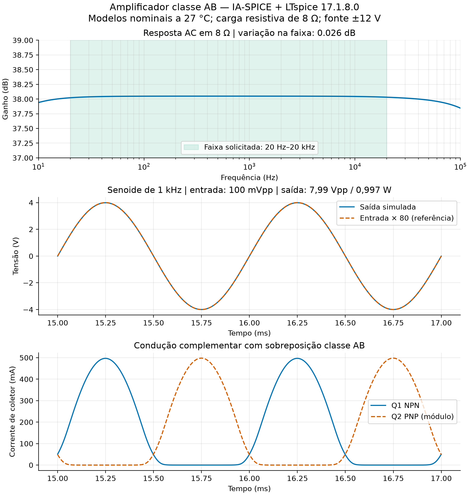

# Amplificador classe AB — 1 W / 8 Ω

Circuito criado e testado com a biblioteca do [IA-SPICE](https://github.com/Caiobinha1/IA-SPICE), commit `31c23cb633cf5292fc11b9a11d0d550fde7ff611`, e LTspice instalado, versão de arquivo **17.1.8.0**. O README do framework menciona LTspice 24; essa versão não foi a utilizada neste trabalho. Data: 19/10/2026.

## Requisitos e critério de aceitação

- Entrada senoidal de **100 mV pico a pico**, carga resistiva de **8 Ω**, faixa **20 Hz a 20 kHz**.
- Potência **1 W** e fonte simétrica **±12 V**, escolhidas pelo usuário.
- Critérios adotados para a simulação: potência nominal ±2% nos três pontos, variação AC menor que 0,5 dB na faixa e THD `.four` menor que 0,1%. Esses limites de variação e distorção foram escolhas de projeto, pois não foram especificados pelo usuário.
- Fonte de sinal ideal, impedância de saída zero. Impedância de entrada nominal: 10 kΩ. A resistência real da fonte deve ser incluída em uma validação posterior, se significativa.

## Dimensionamento e topologia

Para senoide: Vrms = √(1 W × 8 Ω) = **2,828 V**, Vp = **4 V**, Vpp = **8 V**, Ip = **0,5 A**. Vin = 0,05 V de pico; ganho exigido = **80 V/V = 38,062 dB**.

U1 não inversor: A1 = 1 + 18k/2k = **10**. U2 com o par complementar dentro da realimentação: A2 = 1 + (13k+1k)/2k = **8**. Ganho nominal total = **80**. O capacitor de 10 µF e RIN de 10 kΩ dão polo de entrada calculado em **1,59 Hz**. RE1 e RE2 de 0,47 Ω estabilizam a polarização; D1/D2 mantêm ambos os transistores conduzindo perto do cruzamento por zero. A corrente de repouso foi determinada pela simulação, sem supor VBE fixo.

RCOMP = 8,2 kΩ soma-se a RF1∥RG1 = 1,8 kΩ, igualando aproximadamente os 10 kΩ vistos pela outra entrada de U1 e reduzindo o offset por corrente de polarização. CF2 limita a realimentação em alta frequência; RZ/CZ formam uma rede Zobel. Não foi medida margem de fase nem validada carga reativa.

Os valores passivos foram verificados na série E24 por `ia_spice.sizing.snap_to_series`. Os contratos de estágio registrados em `dimensionamento.json` são **estimativas analíticas**, não medições de impedância. Ambos os blocos foram também simulados isoladamente: pré ≈0.999361 Vpp para 100 mVpp; potência ≈0.998439 W com 1 Vpp na entrada.

## Resultados simulados

| Frequência (Hz) | Saída (Vpp) | Saída (Vrms) | Potência (W) | THD `.four` (%) |
|---:|---:|---:|---:|---:|
| 20 | 7.9631 | 2.8154 | 0.990789 | 0.000290 |
| 1,000 | 7.9886 | 2.8242 | 0.997043 | 0.005598 |
| 20,000 | 7.9717 | 2.8183 | 0.992877 | 0.003541 |

Variação AC amostrada na faixa: **0.0263 dB**. Corrente de repouso: Q1 **49.62 mA**, Q2 **49.50 mA**; offset sem sinal **1.121 mV**. A média com senoide nos primeiros 20 ms inclui assentamento do acoplamento e não substitui a medição de offset sem sinal.

A 1 kHz, consumo DC total = **4.248 W**, eficiência calculada ≈**23.5%**. Dissipações médias Q1/Q2 ≈**1,43 W**; no teste a 20 kHz, ≈**1,45 W** cada. Isso exige projeto térmico do cobre/encapsulamento; não é uma montagem validada em protoboard.

## Verificações e limites observados

- Simulações executadas por `ia_spice.simulator.run_ltspice_batch`, leituras por `ia_spice.meas_parser` e curvas RAW por PyLTSpice 6.0.1. Logs, netlists, modelos e resultados JSON acompanham o projeto.
- Esquemático criado com `SchematicBuilder`, usando pinagem do LT1360 e do PNP lida dos símbolos instalados. `verify_asc_netlist` comparou as conexões com a netlist: **zero pinos NC e zero divergências**. O `.asc` compilado também foi simulado, com potência dentro da faixa nominal.
- Passo máximo a 1 kHz reduzido de 200 ns para 100 ns: potência 0.997043 → 0.997044 W; THD 0.005598% → 0.005597%. A diferença é desprezível para o objetivo.
- `.four` usou 10 harmônicas e 10 períodos. A estimativa total do LTspice pode incluir componentes fora da tabela de 10 harmônicas, resíduos de assentamento e discretização. Não equivale a medição de áudio em bancada.
- Entrada dobrada para **200 mVpp**: **2.238 W**, apenas **9.966 Vpp**, THD **17.47%**. Há recorte; esse ponto **não atende** ao critério de baixa distorção. Não se deve extrapolar o ganho 80 para entradas maiores.
- Carga alterada para **16 Ω**, mantendo 100 mVpp: **0.499 W**. Não foi validada carga de 4 Ω.
- Os logs registram falha inicial de Newton e posterior convergência bem-sucedida por Gmin stepping. Nenhum resultado foi aceito apenas porque o processo terminou: as medições necessárias foram conferidas.

## Componentes

| Referências | Valor | Quantidade | Observação |
|---|---|---:|---|
| U1, U2 | LT1360 | 2 | Amplificadores operacionais; alimentação ±12 V |
| Q1 | FZT849 NPN | 1 | Modelo da biblioteca LTspice; SOT223 |
| Q2 | FZT949 PNP | 1 | Modelo oficial Diodes/Zetex; SOT223 |
| D1, D2 | 1N4148 | 2 | Polarização classe AB |
| RIN | 10 kΩ | 1 | Entrada; resistor 1% |
| RCOMP | 8,2 kΩ | 1 | Compensa corrente de polarização de U1 |
| RF1 | 18 kΩ | 1 | Ganho do pré |
| RG1, RG2 | 2 kΩ | 2 | Realimentação; resistor 1% |
| RF2 | 13 kΩ | 1 | Realimentação de potência |
| RF3 | 1 kΩ | 1 | Em série com RF2 |
| RBP, RBN | 2,2 kΩ | 2 | Polarização; 0,25 W |
| RE1, RE2 | 0,47 Ω | 2 | Degeneração; 0,5 W |
| RZ | 10 Ω | 1 | Zobel; 0,5 W |
| CIN | 10 µF | 1 | Preferir bipolar ou filme; acoplamento |
| CF2 | 22 pF | 1 | C0G; compensação |
| CZ, CDP, CDN | 100 nF | 3 | Zobel e desacoplamento local |
| CBP, CBN | 100 µF / 25 V | 2 | Reservatório; respeitar polaridade em cada trilho |
| RLOAD | 8 Ω | 1 | Carga de ensaio; usar ≥5 W no teste físico |

## Abrir e reproduzir

1. Extraia o pacote mantendo os modelos `.lib` na mesma pasta dos circuitos.
2. Abra **classe_ab.asc** no LTspice e execute. As flags iguais representam o mesmo nó; o esquema usa blocos com conexões por nome.
3. Para resposta em frequência, abra **ac.cir**. Os testes de 20 Hz e 20 kHz estão em arquivos próprios. Não ative `.tran` e `.ac` simultaneamente no mesmo teste.
4. Para repetir via IA-SPICE, execute o `reproduzir.py` com Python e `--framework` apontando para o diretório `src` do repositório, e `--ltspice` para o executável. O script confere potência e conectividade do esquema. As dependências Python precisam estar disponíveis.
5. A entrada é `SINE(0 50m FREQ)`: 50 mV de pico corresponde a 100 mV pico a pico. `VEE VEE 0 -12` fornece -12 V; as duas fontes compartilham o terra de sinal.

## Alcance da validação e modelos

**Projeto aprovado em simulação nominal, não validado em hardware.** O alto-falante foi representado por um resistor de 8 Ω. Não foram incluídos impedância dependente de frequência, indutância da bobina, força contraeletromotriz, cabo, tolerâncias, dispersão entre peças, ruído, proteção contra curto ou ligar/desligar, nem autoaquecimento eletrotérmico. O teste nominal não comprova estabilidade com qualquer alto-falante de 8 Ω. Antes de construção, verificar estabilidade em carga reativa, ajuste térmico da polarização, área de cobre e condições de dissipação.

LT1360 e FZT849/1N4148 vieram das bibliotecas da instalação local de LTspice; os avisos existentes foram preservados. FZT949 veio do [modelo oficial Diodes](https://www.diodes.com/spice/download/2961/FZT949.spice.txt), com parâmetros inalterados e declaração normalizada para uma linha; o arquivo original foi preservado. Modelos de terceiros não são relicenciados como parte do IA-SPICE.

Fontes dos componentes: [LT1360 — Analog Devices](https://www.analog.com/en/products/lt1360.html), [FZT849 — Diodes](https://www.diodes.com/part/view/FZT849), [FZT949 — Diodes](https://www.diodes.com/part/view/FZT949). A dissipação admissível dos FZT depende da montagem e do cobre, conforme os datasheets; o valor absoluto máximo não deve ser tomado como desempenho garantido em qualquer placa.

O pacote ZIP contém os circuitos, modelos, logs, CSVs, resultados JSON e relatórios; os arquivos RAW grandes ficam na pasta local de resultados e podem ser regenerados.
